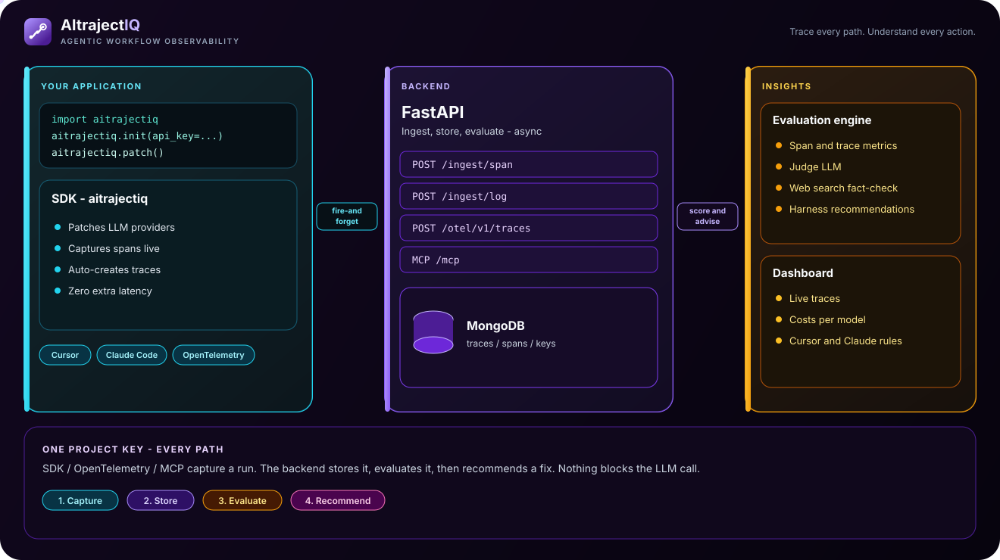

# AItrajectIQ

**Observability and Evaluation Platform for LLM-Powered Applications**

AItrajectIQ is a full-stack platform that helps you monitor, trace, and evaluate every LLM interaction from your application. It captures raw interactions automatically (zero-code), computes evaluation metrics on the backend, and provides rich dashboards for analysis — all without adding latency to your production calls.

> This README covers the **backend** and **SDK** only. The React dashboard (`dashboard/`) has its own README.

---

## Key Features

- **Zero-Code Integration** — Add 3 lines to your application; all LLM calls are captured automatically.
- **Automatic Tracing** — Traces are created automatically if you don't explicitly create them. Calls spaced more than 30 seconds apart create a new trace.
- **20+ Evaluation Metrics** — Faithfulness, hallucination, answer relevance, moderation, RAG metrics, code evaluation, translation scoring, and more.
- **Hierarchical Agent Support** — Auto-detect agent hierarchies from the Python call stack. No manual `agent_span` needed.
- **Fire-and-Forget** — The SDK sends data in daemon threads; zero impact on your application's latency.
- **Multi-Provider** — Automatically captures calls to OpenAI, Azure OpenAI, Anthropic, Google Gemini, Mistral, DeepSeek, Cohere, Groq, Ollama, and any OpenAI-compatible API.
- **Framework Support** — LangChain, LangGraph, CrewAI, AutoGen, LlamaIndex (via provider SDK patching).
- **Any Language, Any Framework (OpenTelemetry)** — The backend is an OTLP/HTTP receiver: anything that emits OpenTelemetry GenAI spans (OpenInference, OpenLLMetry, Vercel AI SDK, Semantic Kernel, Pydantic AI, Strands, LiteLLM, ...) is traced and evaluated without the Python SDK. See [Connect Any Framework with OpenTelemetry](#connect-any-framework-with-opentelemetry).
- **MCP Server for Cursor, Claude & Co.** — Ask Cursor, Claude Code, Claude Desktop or any MCP client about your traces, costs and metrics. See [Use AItrajectIQ from Cursor, Claude and Other MCP Clients](#use-aitrajectiq-from-cursor-claude-and-other-mcp-clients).
- **Project API Keys** — One key identifies the project and authenticates every ingestion path (SDK, OpenTelemetry, MCP). See [API Keys](#api-keys).
- **Configurable Evaluation LLM** — Use OpenAI, Azure OpenAI, Anthropic, or Bedrock as the judge model.
- **Web Search Fact-Checking** — Optional live web search (Tavily, Serper, Brave) for verifying factual claims.
- **Cost Tracking** — Built-in pricing for 40+ models across all major providers.
- **Guardrails** — Prompt injection detection and PII anonymization at ingestion time.

---

## Architecture Overview

<p align="center">
  
</p>

Open [`docs/architecture.svg`](docs/architecture.svg) in a browser to see the motion (packets on the fire-and-forget path, pulsing cards).

Besides the SDK, any OpenTelemetry-instrumented application (any language) can send traces to `/otel/v1/traces`, and MCP clients (Cursor, Claude, ...) can query the results at `/mcp`. Every path is authenticated with a project API key.

### Components

| Component | Description |
|---|---|
| **SDK** (`sdk/aitrajectiq/`) | Python library that monkey-patches LLM provider SDKs to intercept API calls. Sends data to the backend asynchronously. |
| **Backend** (`app/`) | FastAPI server that receives telemetry data, stores it in MongoDB, and runs async evaluation. Two entry points: `main_v2.py` (lightweight) and `main.py` (full with heavy dependencies). |
| **Evaluation Engine** (`app/evaluation/`) | Computes span-level, trace-level, and log-level metrics using a configurable judge LLM. |
| **Database** | MongoDB via Beanie ODM. Collections: `users`, `projects`, `logs`, `traces`, `spans`, `records`. |

---

## SDK Quick Start

### Installation

```bash
pip install -e ./sdk
# Or with specific provider support:
pip install -e "./sdk[openai]"       # OpenAI only
pip install -e "./sdk[anthropic]"    # Anthropic only
pip install -e "./sdk[all]"          # All providers
```

### Zero-Code Integration

```python
import aitrajectiq

# 1. Initialize (once at startup)
aitrajectiq.init(
    api_key="atq_...",                 # project API key (see "API Keys"); it identifies the project
    base_url="http://localhost:8000",  # backend URL
)
# project_id is optional. Without arguments, init() reads AITRAJECTIQ_API_KEY,
# AITRAJECTIQ_PROJECT_ID and AITRAJECTIQ_BASE_URL from the environment.

# 2. Patch all supported providers
aitrajectiq.patch()

# 3. Use your LLM client as usual — all calls are captured automatically
from openai import OpenAI
client = OpenAI(api_key="sk-...")

response = client.chat.completions.create(
    model="gpt-4o",
    messages=[{"role": "user", "content": "Hello!"}],
)
```

### Manual Traces (for complex agents)

```python
with aitrajectiq.trace("agent-run-42", {"user_id": "u-1"}):
    resp1 = client.chat.completions.create(...)   # auto-captured as span
    resp2 = client.chat.completions.create(...)   # auto-captured as span
```

### Tool Spans

```python
with aitrajectiq.tool_span("web_search", {"query": "latest AI news"}) as capture:
    results = search_web("latest AI news")
    capture.set_output(results)   # optional: record the output
```

### Observe Decorator

```python
@aitrajectiq.observe(name="planning")
def plan(messages):
    return client.chat.completions.create(model="gpt-4o", messages=messages)
```

### What the SDK Does NOT Do

- Never sees your provider API keys (OpenAI, Anthropic, etc.)
- Adds zero latency to LLM calls (fire-and-forget in daemon threads)
- Does not modify LLM responses (transparent)
- Does not compute metrics (that's the backend's job)

---

## API Keys

Every ingestion path (SDK, OpenTelemetry, MCP) authenticates with a **project API key**. The key alone identifies the project, so clients don't need to send a `project_id`.

Create a key (or use the Swagger UI at `http://localhost:8000/docs`):

```bash
curl -X POST http://localhost:8000/projects/<project_id>/api-keys \
     -H "Content-Type: application/json" \
     -d '{"name": "my-agent", "scopes": ["ingest", "read"]}'
```

```powershell
Invoke-RestMethod -Method Post -Uri http://localhost:8000/projects/<project_id>/api-keys `
  -ContentType "application/json" -Body '{"name": "my-agent", "scopes": ["ingest", "read"]}'
```

The response contains `"key": "atq_..."`. It is shown **only once**: AItrajectIQ stores its SHA-256 hash, never the key itself.

- **Scopes**: `ingest` (SDK routes, OpenTelemetry receiver, records) and `read` (MCP endpoint). Give coding assistants a read-only key: `{"name": "cursor", "scopes": ["read"]}`.
- **Headers**: `X-API-Key: atq_...` or `Authorization: Bearer atq_...`.
- **List / revoke**: `GET /projects/{id}/api-keys`, `DELETE /projects/{id}/api-keys/{key_id}`. Revocation takes effect within a minute (keys are cached briefly).
- **Check a key**: `GET /auth/whoami` returns its project and scopes.
- **Migration**: the keys used before were never checked. Create a real key and set it in `aitrajectiq.init(api_key=...)` or `AITRAJECTIQ_API_KEY`. Meanwhile, `AITRAJECTIQ_AUTH=permissive` keeps accepting SDK calls that send an existing `project_id` with an unknown key (OpenTelemetry and MCP always require a valid key).

> Project, user and key-management routes are still unauthenticated (unchanged). That is fine on localhost, but put the backend behind authentication before exposing it publicly.

---

## Connect Any Framework with OpenTelemetry

The backend is an OTLP/HTTP receiver, so any agent, framework, language or provider that emits OpenTelemetry spans works without the Python SDK. Point the exporter at AItrajectIQ:

```bash
OTEL_EXPORTER_OTLP_ENDPOINT=http://localhost:8000/otel     # exporters append /v1/traces and /v1/logs
OTEL_EXPORTER_OTLP_PROTOCOL=http/protobuf                  # or http/json; gRPC is not supported
OTEL_EXPORTER_OTLP_HEADERS=x-api-key=atq_...
```

If you set the signal-specific `OTEL_EXPORTER_OTLP_TRACES_ENDPOINT` instead, give the full URL: `http://localhost:8000/otel/v1/traces`. `python test_app/otel_smoke.py` sends a sample agent trace end to end.

### Python: any framework through an instrumentation library

**OpenInference** (LangChain/LangGraph, LlamaIndex, CrewAI, OpenAI Agents SDK, smolagents, DSPy, Haystack, OpenAI, Anthropic, Bedrock, Gemini, LiteLLM, ...):

```bash
pip install opentelemetry-sdk opentelemetry-exporter-otlp-proto-http openinference-instrumentation-langchain
```

```python
from opentelemetry import trace
from opentelemetry.sdk.trace import TracerProvider
from opentelemetry.sdk.trace.export import BatchSpanProcessor
from opentelemetry.exporter.otlp.proto.http.trace_exporter import OTLPSpanExporter
from openinference.instrumentation.langchain import LangChainInstrumentor

provider = TracerProvider()
provider.add_span_processor(BatchSpanProcessor(OTLPSpanExporter()))  # reads the OTEL_EXPORTER_OTLP_* variables
trace.set_tracer_provider(provider)
LangChainInstrumentor().instrument(tracer_provider=provider)
```

Swap the instrumentor for your stack: `openinference-instrumentation-crewai`, `-llama-index`, `-openai-agents`, `-openai`, `-anthropic`, and so on.

**OpenLLMetry** (Traceloop):

```bash
pip install traceloop-sdk
TRACELOOP_BASE_URL=http://localhost:8000/otel
TRACELOOP_HEADERS="x-api-key=atq_..."
```

```python
from traceloop.sdk import Traceloop
Traceloop.init(app_name="my-agent")
```

**LiteLLM** (100+ providers behind one API):

```python
import litellm
litellm.callbacks = ["otel"]
# OTEL_EXPORTER=otlp_http
# OTEL_ENDPOINT=http://localhost:8000/otel/v1/traces
# OTEL_HEADERS="x-api-key=atq_..."
```

### TypeScript / JavaScript: Vercel AI SDK

```ts
import { NodeSDK } from "@opentelemetry/sdk-node";
import { OTLPTraceExporter } from "@opentelemetry/exporter-trace-otlp-proto";
import { generateText } from "ai";

new NodeSDK({ traceExporter: new OTLPTraceExporter() }).start(); // reads the OTEL_EXPORTER_OTLP_* variables

await generateText({
  model,
  prompt: "...",
  experimental_telemetry: { isEnabled: true, functionId: "support-agent" },
});
```

In Next.js, `registerOTel()` from `@vercel/otel` in `instrumentation.ts` does the same.

### Frameworks with built-in OpenTelemetry

Semantic Kernel, AutoGen, Pydantic AI, Strands Agents, Google ADK and others emit GenAI spans natively. Configure an OTLP/HTTP exporter with the variables above and turn on the framework's tracing (for example `Agent(..., instrument=True)` in Pydantic AI, or `StrandsTelemetry().setup_otlp_exporter()` in Strands).

### Prompts and responses

Evaluation metrics need the message content, which some instrumentations don't record by default:

- Official OpenTelemetry GenAI instrumentations: set `OTEL_INSTRUMENTATION_GENAI_CAPTURE_MESSAGE_CONTENT=true`. They emit the content as log events, so export logs too (`OTEL_LOGS_EXPORTER=otlp`); AItrajectIQ merges them into their spans.
- OpenLLMetry: `TRACELOOP_TRACE_CONTENT=true` (the default).
- OpenInference: captured by default.

LLM spans without any content are stored (tokens, cost, latency) but not evaluated.

### How OpenTelemetry data is mapped

- One OpenTelemetry trace becomes one AItrajectIQ trace (`source: "otel"`). The MCP tools also accept the 32-character OTel trace id.
- GenAI semantic conventions (`gen_ai.*`), OpenInference, OpenLLMetry and Vercel AI SDK attributes become `llm`, `tool`, `agent`, `chain`, `retriever` or `embedding` spans. Spans without GenAI or agent attributes (HTTP, database, ...) are dropped.
- When two instrumentations report the same call (for example LangChain and the OpenAI SDK), only the innermost LLM span counts toward tokens and cost.
- OpenTelemetry has no "trace finished" signal: a trace is closed and evaluated when its root span arrives, or after `AITRAJECTIQ_OTEL_IDLE_S` seconds (default 60) without new spans.
- Cost comes from the instrumentation when it reports one, otherwise from the built-in price table.

---

## Use AItrajectIQ from Cursor, Claude and Other MCP Clients

The backend serves an MCP endpoint at `http://localhost:8000/mcp` (Streamable HTTP). Once it's added to your assistant, you can ask things like *"Which traces failed this week and what did they cost?"*. The tools are read-only and only see the project of the API key:

| Tool | Returns |
|---|---|
| `get_project_overview` | Traces, failures, LLM/tool calls, tokens, cost and average duration over N days |
| `list_traces` | Recent traces with status, cost, duration and trace metrics |
| `get_trace` | One trace step by step: span tree, models, tokens, errors, metrics |
| `get_costs` | Cost, calls and tokens grouped by model, provider or day |
| `get_metrics_summary` | Average of every span- and trace-level evaluation metric |
| `find_problem_spans` | Failed spans, slow spans, or spans with a poor metric score |
| `list_logs` | Recent conversational logs with guardrail flags and metrics |

Use a key with the `read` scope (see [API Keys](#api-keys)).

**Cursor**: `~/.cursor/mcp.json` (all projects) or `.cursor/mcp.json` (one project):

```json
{
  "mcpServers": {
    "aitrajectiq": {
      "url": "http://localhost:8000/mcp",
      "headers": { "Authorization": "Bearer atq_..." }
    }
  }
}
```

**Claude Code**:

```bash
claude mcp add --transport http aitrajectiq http://localhost:8000/mcp --header "Authorization: Bearer atq_..."
```

**Claude Desktop** only launches local (stdio) servers, so bridge with [`mcp-remote`](https://www.npmjs.com/package/mcp-remote) (needs Node.js) in `claude_desktop_config.json`:

```json
{
  "mcpServers": {
    "aitrajectiq": {
      "command": "npx",
      "args": ["-y", "mcp-remote", "http://localhost:8000/mcp", "--header", "Authorization:${AITRAJECTIQ_AUTH}"],
      "env": { "AITRAJECTIQ_AUTH": "Bearer atq_..." }
    }
  }
}
```

Keeping the header value in `env` avoids a Windows quoting issue with spaces inside `args`. For a non-localhost `http://` URL, add `--allow-http`.

**VS Code (Copilot)**: `.vscode/mcp.json`:

```json
{
  "servers": {
    "aitrajectiq": {
      "type": "http",
      "url": "http://localhost:8000/mcp",
      "headers": { "Authorization": "Bearer atq_..." }
    }
  }
}
```

**Windsurf, Cline, Continue, Gemini CLI and other clients**: add a Streamable HTTP server with the same URL and `Authorization` header.

To test the endpoint without an assistant, run `python test_app/mcp_smoke.py`, or the MCP Inspector (`npx @modelcontextprotocol/inspector`, transport "Streamable HTTP"). Web connectors (Claude.ai, ChatGPT) need the backend on a public HTTPS URL.

---

## Backend Setup

### Prerequisites

- Python 3.9+
- MongoDB (default: `mongodb://localhost:28018`)

### Environment Variables (`.env`)

```bash
# Required: MongoDB is configured in app/config/db.py
# Default: mongodb://localhost:28018 / database: llm_insight_sdk_db

# Optional: Eval LLM configuration
EVAL_LLM_PROVIDER=openai       # openai | azure | anthropic | bedrock
EVAL_LLM_MODEL=gpt-4o
EVAL_LLM_API_KEY=sk-...
EVAL_LLM_BASE_URL=             # optional, for OpenAI-compatible APIs

# Optional: Fact-checking via web search
FACT_CHECK_PROVIDER=none       # none | tavily | serper | brave
FACT_CHECK_API_KEY=

# Optional: API key enforcement (see "API Keys")
AITRAJECTIQ_AUTH=enforce        # enforce | permissive (legacy SDK calls without a known key)

# Optional: OpenTelemetry receiver
AITRAJECTIQ_OTEL_IDLE_S=60      # close an OTel trace after N seconds without spans if its root never arrives
AITRAJECTIQ_EVAL_CONCURRENCY=4  # max evaluations calling the judge LLM at the same time

# Optional: For main.py (full) — Sentence Transformers, FAISS, etc.
```

`requirements.txt` includes `opentelemetry-proto` (OTLP protobuf decoding) and `mcp` (the `/mcp` endpoint). If either is missing, the backend still starts: protobuf OTLP requests get a 415 explaining what to install (OTLP/JSON keeps working) and `/mcp` is disabled with a warning in the logs.

### Running

**Lightweight (recommended):** Loads only essential routes and dependencies.

```bash
cd app
uvicorn main_v2:app --reload --port 8000
```

**Full:** Includes fact-checking retriever, prompt injection, translation evaluation, etc.

```bash
cd app
uvicorn main:app --reload --port 8000
```

The API will be available at `http://127.0.0.1:8000/docs` (Swagger UI).

### Configuring the Eval LLM

The evaluation LLM is configurable via `configure_eval_llm()` in `app/evaluation/runner.py`:

```python
from evaluation.runner import configure_eval_llm, EvalLLMConfig

configure_eval_llm(EvalLLMConfig(
    provider="openai",          # openai | azure | anthropic | bedrock
    model="gpt-4o",             # any model ID
    api_key="sk-...",
    base_url=None,              # for Ollama, Groq, DeepSeek, etc.
    azure_endpoint=None,        # for Azure OpenAI
    azure_api_version="2024-02-15-preview",
))
```

---

## Backend API

### Ingest Routes (SDK → Backend)

| Method | Endpoint | Description |
|---|---|---|
| POST | `/ingest/trace/start` | Create a new trace |
| POST | `/ingest/trace/end` | Close a trace and trigger trace-level evaluation |
| POST | `/ingest/span` | Store a span (LLM call or tool call) and trigger span-level evaluation |
| POST | `/ingest/log` | Ingest a conversational log with guardrail scanning and async metrics |
| POST | `/otel/v1/traces` | OTLP/HTTP traces (protobuf or JSON, optionally gzip) |
| POST | `/otel/v1/logs` | OTLP/HTTP logs: GenAI content events linked to spans |
| POST | `/otel/v1/metrics` | Accepted and ignored (so exporters configured for every signal don't fail) |

All ingest routes require a project API key (`X-API-Key` or `Authorization: Bearer`). `project_id` in request bodies is optional; when sent, it must match the key's project.

### MCP Endpoint

| Method | Endpoint | Description |
|---|---|---|
| POST | `/mcp` | MCP Streamable HTTP endpoint (needs a key with the `read` scope) |

### Read Routes

| Method | Endpoint | Description |
|---|---|---|
| GET | `/traces/` | List traces for a project (with filters) |
| GET | `/traces/stats` | Aggregate stats across all traces for a project |
| GET | `/traces/{trace_id}` | Trace detail with all spans |
| GET | `/traces/{trace_id}/cost` | Cost breakdown by model and provider |
| GET | `/traces/{trace_id}/summary` | Human-readable trace summary |
| GET | `/metrics/aggregate/spans` | Time-series of span-level metrics |
| GET | `/metrics/aggregate/traces` | Time-series of trace-level metrics |
| GET | `/metrics/summary` | Quick summary of all metrics over N days |
| GET | `/logs/` | List conversation logs |
| GET | `/logs/{log_id}` | Get log detail |
| POST | `/logs/filter` | Filter logs by arbitrary fields |
| POST | `/logs/` | Create a log (legacy) |
| PATCH | `/logs/{log_id}/request_analysis` | Add guardrail analysis to a log |
| PATCH | `/logs/{log_id}/response` | Add response data to a log |
| PATCH | `/logs/{log_id}/final_analysis` | Add metrics to a log |

### CRUD Routes

| Method | Endpoint | Description |
|---|---|---|
| GET/POST | `/projects/` | List / create projects |
| GET/PATCH/DELETE | `/projects/{id}` | Read / update / delete project |
| GET | `/projects/{id}/export` | Export project config as JSON |
| POST | `/projects/import` | Import project config |
| POST | `/projects/{id}/api-keys` | Create an API key (the raw key is returned once) |
| GET | `/projects/{id}/api-keys` | List the project's API keys (masked) |
| DELETE | `/projects/{id}/api-keys/{key_id}` | Revoke an API key |
| GET | `/auth/whoami` | Project and scopes of the calling API key |
| GET/POST | `/users/` | List / create users |
| GET/PATCH/DELETE | `/users/{id}` | Read / update / delete user |
| GET/POST | `/records/` | List / create classification records |
| GET/DELETE | `/records/{id}` | Read / delete record |

> **Note:** The legacy proxy routes (`/v1/chat/completions`) in `app/proxy/` are deprecated. Use `/ingest/log` instead.

---

## Evaluation System

The evaluation engine computes metrics at three levels:

### Span-Level (per LLM call)

Evaluated asynchronously when a span is ingested. Each LLM span is evaluated against the metrics enabled on the project.

| Metric | Description |
|---|---|
| `general_faithfulness` | Does the response stay faithful to the input context? Two modes: context-only (agents) or web search (generative). |
| `hallucination` | Detects claims in the response that are NOT supported by the input context. |
| `answer_relevance` | How relevant is the response to the user's query (0.0–1.0). |
| `moderation` | Safety score (0.0 = safe, 1.0 = extremely unsafe). Checks for violence, hate speech, sexual content, etc. |
| `is_json` | Is the response valid JSON? |
| `output_format_compliance` | Does the response follow the requested output format? |
| `token_efficiency` | Ratio of output tokens to input tokens. |
| `latency_classification` | Categorizes latency as fast / normal / slow / very_slow. |

### Trace-Level (per trace)

Evaluated asynchronously when a trace is closed. Uses all spans in the trace for analysis. Agent runs (Cursor, Claude Code, or any trace with tool calls or subagents) get these four metrics:

| Metric | Description |
|---|---|
| `task_completion` | Did the agent do what was asked, judged from the request, the actions and the final answer? |
| `claims_grounded` | Share of the final answer's claims (file changed, tests passing…) proven by the executed actions. |
| `instruction_adherence` | Did the agent do what was asked and only that, following the user's explicit constraints? |
| `tool_error_rate` | Proportion of tool calls that resulted in errors. |

### Log-Level (per conversational log)

Evaluated asynchronously when a log is ingested via `/ingest/log`. Supports a subset of span-level metrics: `general_faithfulness`, `hallucination`, `answer_relevance`, `moderation`, `output_format_compliance`.

### Web Search Fact-Checking

When `FACT_CHECK_PROVIDER` is configured (Tavily, Serper, or Brave), the evaluation engine:
1. Extracts verifiable factual claims from the response.
2. Searches the web for each claim.
3. Uses the LLM judge to verify each claim against web evidence.

This is used for `general_faithfulness` and `hallucination` when the project is a generative LLM (not a structured agent).

### Configuring Metrics Per Project

Metrics are selected at project creation. Each project type has recommended metrics:

| Project Task | Available Metric Families |
|---|---|
| `generic` | Generic, Heuristic, Summarization, Translation, Code, RAG |
| `translation` | Heuristic, Translation |
| `summarization` | Heuristic, Summarization |
| `code_generation` | Heuristic, Code |
| `agent` | Generic, Heuristic, Agent Span, Agent Trace |

---

## Metrics Catalog

### Generic (LLM-Judge Based)

| Metric Name | Type | Description |
|---|---|---|
| `general_faithfulness` | `float` (0–1) | Response stays faithful to input context |
| `hallucination` | `list[str]` | Claims not supported by context |
| `answer_relevance` | `float` (0–1) | Relevance of response to query |
| `moderation` | `float` (0–1) | Content safety score |
| `completeness` | `float` (0–1) | How complete the response is |

### Heuristic

| Metric Name | Type | Description |
|---|---|---|
| `equals` | `bool` | Response equals expected value |
| `contains` | `bool` | Response contains expected substring |
| `matches_regex` | `bool` | Response matches a regex pattern |
| `is_json` | `bool` | Response is valid JSON |
| `levenshtein` | `float` | Levenshtein distance to expected value |

### RAG

| Metric Name | Type | Description |
|---|---|---|
| `context_precision` | `float` (0–1) | Precision of retrieved context |
| `context_recall` | `float` (0–1) | Recall of retrieved context |
| `contextual_faithfulness` | `float` (0–1) | Faithfulness to retrieved context |

### Summarization

| Metric Name | Type | Description |
|---|---|---|
| `summary_completeness` | `float` (0–1) | Completeness of the summary |
| `conciseness` | `float` (0–1) | How concise the summary is |
| `compression_ratio` | `float` | Ratio of summary length to original |

### Translation

| Metric Name | Type | Description |
|---|---|---|
| `comet_score` | `float` (0–1) | COMET translation quality score |

### Code

| Metric Name | Type | Description |
|---|---|---|
| `compilable` | `bool` | Generated code can be compiled |
| `code_relevance` | `float` (0–1) | Relevance of code to the task |

### Agent (Span-Level)

| Metric Name | Type | Description |
|---|---|---|
| `output_format_compliance` | `bool` | Response follows requested format |
| `token_efficiency` | `float` | out/in token ratio |
| `latency_classification` | `str` | fast / normal / slow / very_slow |

### Agent (Trace-Level)

| Metric Name | Type | Description |
|---|---|---|
| `task_completion` | `bool` | Task completed successfully |
| `claims_grounded` | `float` (0–1) | Claims of the final answer proven by actions |
| `instruction_adherence` | `float` (0–1) | Request and constraints followed |
| `tool_error_rate` | `float` | Errors / total tool calls |

---

## Agent Tracing

AItrajectIQ supports two modes for tracing hierarchical agent systems:

### 1. Manual Agent Spans

Use `agent_span` context managers to define agent boundaries explicitly:

```python
with aitrajectiq.trace("pipeline"):
    with aitrajectiq.agent_span("manager", role="manager"):
        # Manager's LLM calls are captured here
        resp = client.chat.completions.create(...)

        with aitrajectiq.agent_span("worker-search", role="worker"):
            r1 = client.chat.completions.create(...)

        with aitrajectiq.agent_span("worker-write", role="worker"):
            r2 = client.chat.completions.create(...)
```

### 2. Zero-Code Auto-Detection (Recommended)

The SDK automatically detects the agent hierarchy from the Python call stack. Each captured span includes a `caller_chain` field showing the full function call path:

```python
# No aitrajectiq.agent_span needed — the SDK detects the hierarchy
def manager(question):
    resp = client.chat.completions.create(...)  # caller_chain: ["manager"]
    result = worker(question)                   # caller_chain: ["manager", "worker"]
    return result

def worker(question):
    return client.chat.completions.create(...)   # caller_chain: ["manager", "worker"]
```

This works with any Python agent framework — no framework-specific instrumentation required.

---

## Guardrails

AItrajectIQ provides built-in guardrails at log ingestion time (`/ingest/log`):

### Prompt Injection Detection

Uses `llm-guard`'s PromptInjection scanner (threshold: 0.5). If detected, the log is marked as `blocked` with a reason.

### PII Anonymization

Uses `llm-guard`'s Anonymize scanner with BERT-based NER. User messages are anonymized before storage. The log is flagged with `contains_pii` and `anonymized` fields.

### Guardrails in the SDK

The SDK also supports client-side guardrails for proactive blocking:

```python
import aitrajectiq

aitrajectiq.configure_guardrails(block_on_prompt_injection=True)
aitrajectiq.add_guardrail("block_pii", enabled=True)

try:
    response = client.chat.completions.create(...)  # blocked by guardrail
except aitrajectiq.PromptBlockedError as e:
    print(f"Blocked: {e}")
```

---

## Cost Tracking

Built-in pricing for 40+ models from all major providers (prices per 1M tokens in USD):

| Provider | Models |
|---|---|
| **OpenAI** | GPT-5.4, GPT-4.1, GPT-4o, GPT-4, GPT-3.5, o3, o4-mini, o1 |
| **Anthropic** | Claude Opus 4.x, Sonnet 4.x, Haiku 4.5/3.5, Claude 3 series |
| **Google** | Gemini 2.5 Pro/Flash, 2.0 Flash, 1.5 Pro/Flash |
| **Mistral** | Mistral Large/Small/Medium, Codestral |
| **DeepSeek** | DeepSeek Chat, DeepSeek Reasoner |
| **Cohere** | Command R+, Command R, Command A |
| **Meta** | Llama 4 Maverick/Scout, Llama 3.3/3.1 |

Unknown models default to a conservative price. Cost is computed in the backend at span ingestion.

Model ids are matched against the table by name, longest match first (`gpt-4o-mini-2024-07-18` uses the `gpt-4o-mini` price, not `gpt-4o`), and Claude ids written with dashes (`claude-opus-4-5-20251101`) match their dotted entry (`claude-opus-4.5`).

Because costs are stored at ingestion, a change to the price table only applies to new spans. To recompute the costs already stored for SDK spans, along with their trace totals and cost metrics:

```bash
cd app
python -m scripts.recompute_costs            # dry run: shows what would change
python -m scripts.recompute_costs --apply    # writes the corrected costs
```

---

## Demos

Demo applications live in `test_app/`:

| Script | Description |
|---|---|
| `test_app/chatbot.py` | Simple chatbot instrumented with the SDK. |
| `test_app/demo_agent_hierarchy.py` | Multi-agent workflow showing how the SDK builds the agent tree. |
| `test_app/otel_smoke.py` | Sends an OpenTelemetry agent trace and checks it was ingested. |
| `test_app/mcp_smoke.py` | Calls the `/mcp` tools like an MCP client would. |

Run any demo with:

```bash
# Via the SDK CLI (instruments the script automatically)
python -m aitrajectiq run test_app/demo_agent_hierarchy.py

# Or directly
python test_app/demo_agent_hierarchy.py
```

> **Note:** The backend must be running for demos to send data successfully.

### SDK CLI

The SDK provides a CLI for running any Python script with automatic instrumentation:

```bash
python -m aitrajectiq run my_agent_script.py
```

This patches the LLM providers and wraps the script execution in a trace — no code changes needed.

---

## Project Structure

```
aitrajectiqSDK/
├── README.md                     # This file
├── requirements.txt              # Backend Python dependencies
├── .env                          # Environment variables (not tracked)
│
├── app/                          # Backend (FastAPI)
│   ├── main.py                   # Full entry point (heavy deps)
│   ├── main_v2.py                # Lightweight entry point (recommended)
│   ├── extensions.py             # Wires API keys, the OTLP receiver and /mcp into an app
│   ├── config/
│   │   └── db.py                 # MongoDB + Beanie initialization
│   ├── models/
│   │   ├── project.py            # Project document (task, metrics config)
│   │   ├── trace.py              # Trace document
│   │   ├── span.py               # Span document (LLM, tool, agent, chain, retriever, embedding)
│   │   ├── metric.py             # Metric enum + model (all metric names)
│   │   ├── log.py                # Conversational log document
│   │   ├── user.py               # User document
│   │   ├── record.py             # Classification record document
│   │   ├── apikey.py             # Project API key document (hashed keys, scopes)
│   │   └── otel_event.py         # Buffered OTLP GenAI content events
│   ├── security/
│   │   └── api_keys.py           # Key generation, hashing, lookup, FastAPI dependency
│   ├── otel/                     # OpenTelemetry receiver
│   │   ├── routes.py             # /otel/v1/traces, /logs, /metrics
│   │   ├── decode.py             # OTLP protobuf / JSON / gzip decoding
│   │   ├── mapping.py            # GenAI conventions → AItrajectIQ span fields
│   │   ├── finalize.py           # Trace finalization helpers (pure)
│   │   └── ingest.py             # Persistence, trace lifecycle, idle sweeper
│   ├── mcp_server/
│   │   └── server.py             # MCP endpoint (/mcp) and its tools
│   ├── services/
│   │   └── insights.py           # Queries shared by the REST routes and MCP tools
│   ├── tests/                    # Unit tests (pytest, no database needed)
│   ├── scripts/
│   │   └── recompute_costs.py    # Recompute stored span/trace costs after a price fix
│   ├── routes/
│   │   ├── api_key_routes.py     # API key management + /auth/whoami
│   │   ├── ingest.py             # Trace + span ingestion (SDK → backend)
│   │   ├── ingest_logs.py        # Log ingestion with guardrails
│   │   ├── traces.py             # Trace/span read endpoints
│   │   ├── metrics.py            # Metrics aggregation + time-series
│   │   ├── log_routes.py         # Log CRUD (legacy)
│   │   ├── project_routes.py     # Project CRUD + export/import
│   │   ├── user_routes.py        # User CRUD
│   │   ├── record_routes.py      # Classification record CRUD
│   │   └── help_route.py         # Help endpoint
│   ├── evaluation/
│   │   ├── runner.py             # Span + trace evaluation engine
│   │   ├── scheduler.py          # Background evaluation tasks (bounded concurrency)
│   │   ├── log_runner.py         # Log-level metrics evaluation
│   │   └── web_search.py         # Web search for fact-checking
│   ├── utils/
│   │   ├── cost.py               # Cost computation (40+ models)
│   │   ├── math_utils.py         # Math utilities
│   │   └── time.py               # Time utilities
│   ├── resources/                # RAG resources (optional)
│   │   ├── fill_db_from_json.py  # DB population script
│   │   ├── models/               # Category/Chunk models
│   │   └── routes/               # Category/Chunk routes
│   └── FactChecker/              # Web search retriever for fact-checking
│       ├── retriever.py
│       └── test_router.py
│
├── sdk/                          # AItrajectIQ SDK
│   ├── setup.py                  # Package setup
│   ├── README.md                 # SDK-specific README (French)
│   └── aitrajectiq/
│       ├── __init__.py           # Public API (init, patch, trace, etc.)
│       ├── __main__.py           # CLI entry point
│       ├── client.py             # HTTP client (fire-and-forget)
│       ├── context.py            # Context management (trace, span, hierarchy)
│       ├── wrappers.py           # Monkey-patches for all providers
│       ├── guardrails.py         # Client-side guardrails
│       ├── _bootstrap.py         # Auto-instrumentation support
│       ├── cli.py                # CLI (run scripts with instrumentation)
│       └── integrations/
│           └── langchain.py      # LangChain callback integration
│
├── dashboard/                    # React + Vite dashboard
│
└── test_app/                     # Test applications
    ├── chatbot.py
    ├── demo_agent_hierarchy.py
    ├── otel_smoke.py             # Sends an OpenTelemetry agent trace and checks it was ingested
    └── mcp_smoke.py              # Calls the /mcp tools like an MCP client would
```

---

## Development Stack

| Layer | Technology |
|---|---|
| **Backend** | Python 3.9+, FastAPI, Uvicorn |
| **Database** | MongoDB (via Motor + Beanie ODM) |
| **SDK** | Python, monkey-patching (wrapt), threading |
| **Evaluation LLM** | OpenAI, Azure OpenAI, Anthropic, Bedrock (configurable) |
| **Web Search** | Tavily, Serper (Google), Brave Search (configurable) |
| **Guardrails** | llm-guard (prompt injection, PII anonymization) |
| **Translation Eval** | Unbabel COMET |
| **Embeddings** | Sentence Transformers (BAAI/bge-large-en-v1.5) |
| **Vector Search** | FAISS |

---

## Related

- [SDK README](sdk/README.md) — Detailed SDK documentation (in French)
- [Dashboard README](dashboard/README.md) — Dashboard setup and usage

